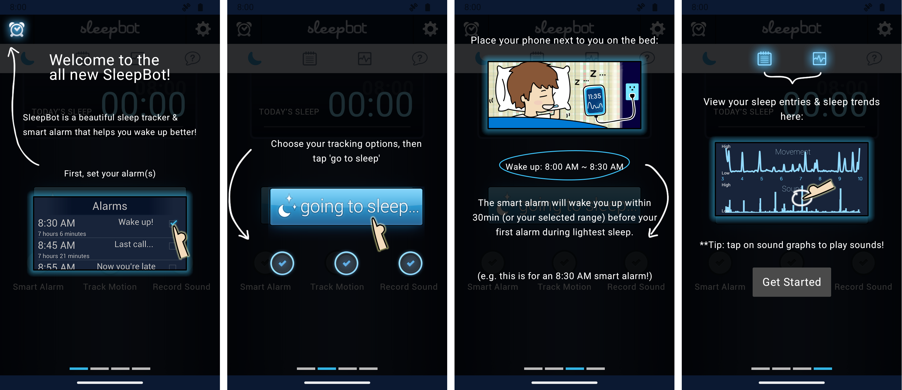

# SleepBot 4.0

A modern rebuild of **SleepBot 3.2.8** (2013–2015) in Kotlin + Jetpack Compose. Behaviour, formulas,
texts, translations and the original artwork were carried over from the 3.2.8 APK, while platform
plumbing was modernised.



## Download

Grab the latest APK from [Releases](https://github.com/tkfoss/sleepbot/releases/latest).

## Build

```sh
./gradlew assembleDebug          # app/build/outputs/apk/debug/app-debug.apk
./gradlew testDebugUnitTest      # stats / debt / formatting tests
```

Requires JDK 17+ and an Android SDK with platform 37 (`local.properties` → `sdk.dir`).

### Releasing

Bump `versionCode`/`versionName` in `app/build.gradle.kts`, then push a matching tag
(`git tag v4.0.0 && git push origin v4.0.0`). The `Release` workflow builds a signed APK and
publishes it as a GitHub release. It needs these repo secrets: `KEYSTORE_BASE64`
(`base64 -i release.jks`), `KEYSTORE_PASSWORD`, `KEY_ALIAS`, `KEY_PASSWORD`.

Translations in `res/values-*/strings.xml` were ported once from 3.2.8 and are now maintained by hand.
Strings missing from a language fall back to English.

## Differences from 3.2.8

- **No server.** mysleepbot.com cloud sync, Facebook, C2DM, Flurry/Crashlytics are gone. Data is
  covered by Android's Google backup (DB + prefs, see `res/xml/*backup*`) and manual JSON backup / CSV
  export via the system file picker.
- Settings Android no longer allows apps to change were dropped: auto flight mode / mobile data,
  Wi-Fi off, lock-screen text, App2SD, keyguard hacks.
- Smart alarm no longer rewrites the user's stored alarm time; it rings early and skips that
  occurrence instead (same observable behaviour).
- Sound clips are recorded with `AudioRecord` into app-private storage instead of the SD card.
- Known original bugs fixed: inverted sound-sensitivity labels, last sound record never saved,
  session reset orphaning sensor data, empty "Punched in since" time, selectable optimal-hour range.
